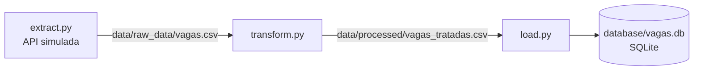

# Pipeline de Dados de Vagas (Python + SQL)

Pipeline ETL de estudo que simula a coleta de vagas de emprego, trata os dados com Pandas e carrega o resultado em um banco SQLite.

> Este foi o primeiro protótipo do projeto. A versão completa, com scrapers reais, PostgreSQL, testes e CI, está no [hub_vagas](https://github.com/Willian-Cruz/hub_vagas).

---

## Pipeline



| Etapa | O que faz |
| --- | --- |
| Extract | Gera vagas simuladas (incluindo uma duplicada e uma sem localização) e salva o CSV bruto |
| Transform | Remove duplicados, preenche localização nula com "Não identificado" e cria a coluna `nivel` |
| Load | Cria a tabela a partir de `database/schema.sql` e carrega as vagas tratadas no SQLite |

## Estrutura

```text
Projeto_etl_vagas/
├── data/
│   ├── raw_data/vagas.csv          # dados brutos
│   └── processed/vagas_tratadas.csv # dados tratados
├── database/
│   └── schema.sql                  # estrutura da tabela vagas
├── scripts/
│   ├── extract.py
│   ├── transform.py
│   └── load.py
├── main.py                         # orquestra as três etapas
└── requirements.txt
```

O banco `database/vagas.db` é gerado ao rodar o pipeline e não é versionado.

## Tecnologias

Python, Pandas, SQLite e SQL.

## Como executar

```bash
git clone https://github.com/Willian-Cruz/Projeto_etl_vagas.git
cd Projeto_etl_vagas
python -m venv venv
source venv/bin/activate        # Windows: venv\Scripts\activate
pip install -r requirements.txt
python main.py
```

Saída esperada:

```text
Iniciando extração...
Extração concluída: 4 linhas em .../data/raw_data/vagas.csv
Iniciando transformação...
Transformação concluída: 4 -> 3 linhas em .../data/processed/vagas_tratadas.csv
Iniciando carga...
Carga concluída: 3 vagas em .../database/vagas.db
```
